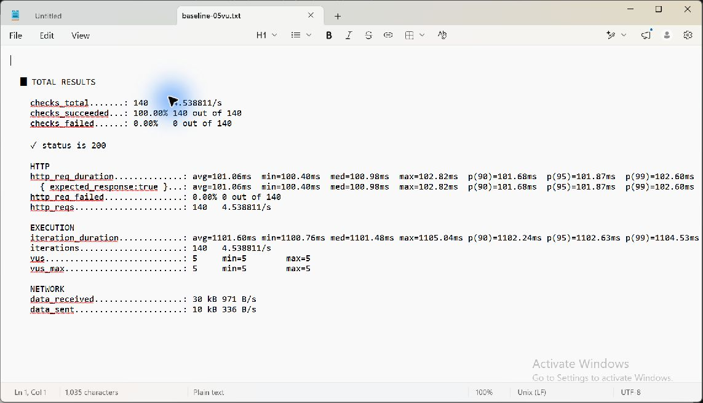
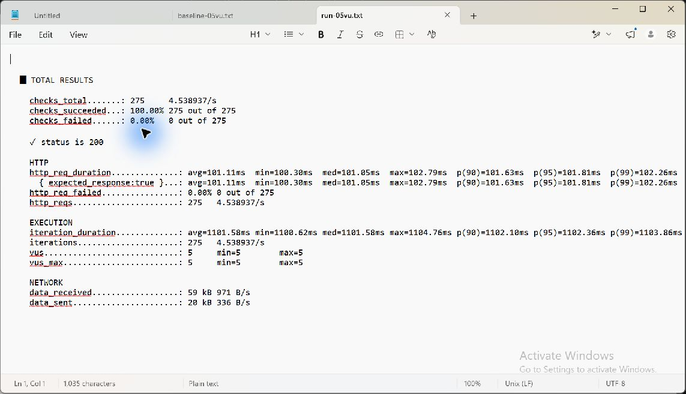
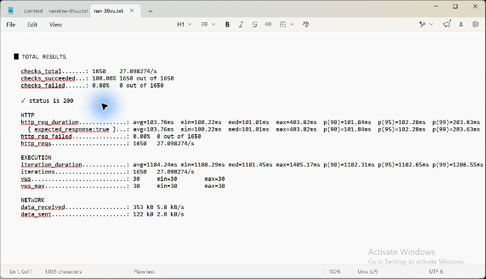
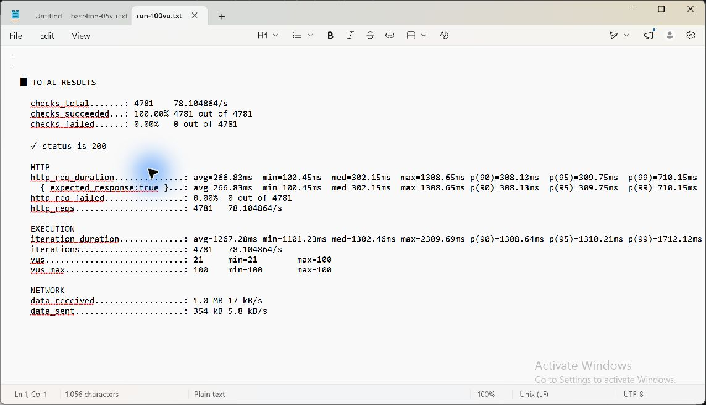
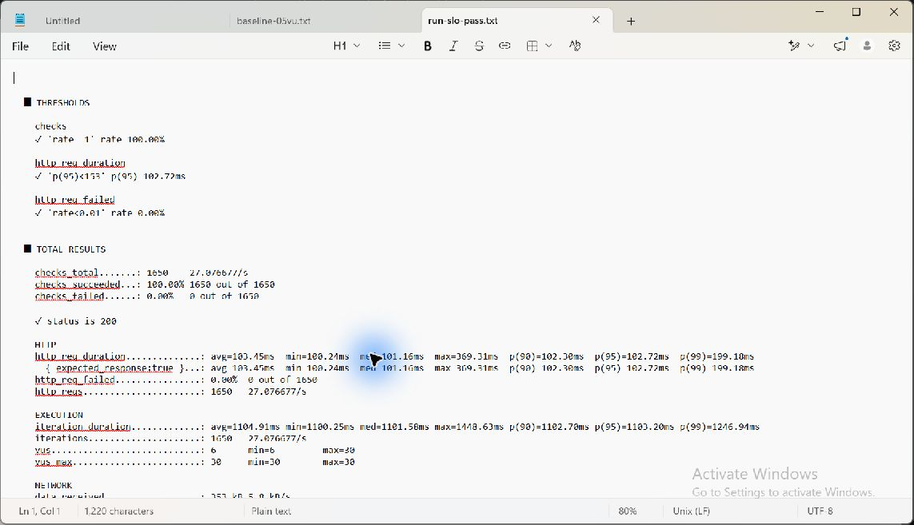
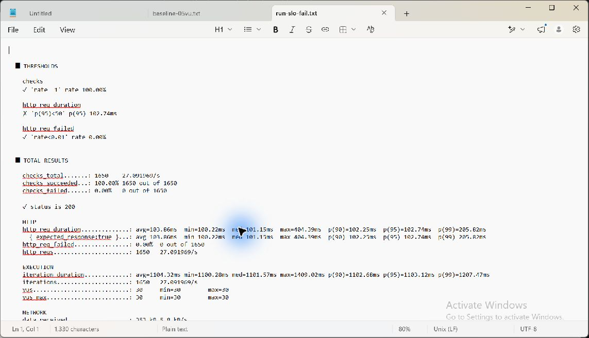
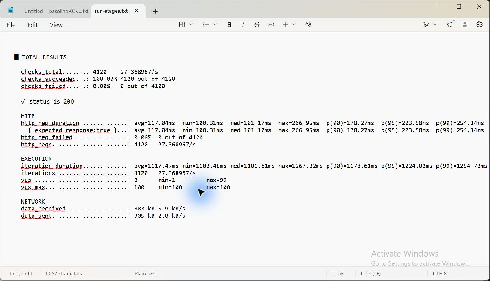
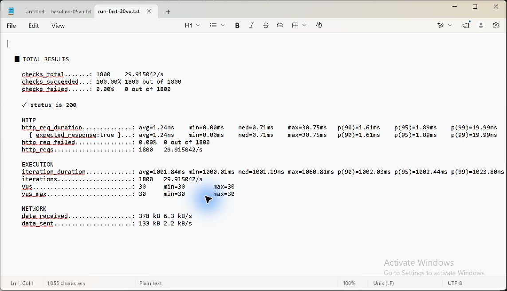

# Лаборатори 2 — Гүйцэтгэлийн хэмжүүрийг k6-аар хэмжих

F.CSA313 — Программ хангамжийн чанарын баталгаа ба тест, 2026.

Энэ ажлаар k6 ашиглан latency, throughput, error rate-ийг бодитоор хэмжив.
Локал сервер 30 VU үед 153 ms SLO-г хангасан бол 100 VU үед p95 309.75 ms
болж өссөн. Хэмжилтийн эх текст, JSON, ажиллуулалтын цаг, exit code болон
дэлгэцийн зургуудыг репозиторид хадгалсан.

## Ажиллуулах

Python 3 болон [Grafana k6](https://grafana.com/docs/k6/latest/set-up/install-k6/)
суулгасан орчинд дараах командуудыг ашиглана.

```bash
python server.py
# Өөр terminal нээнэ.
k6 run script.js
k6 run -e TARGET_URL=http://127.0.0.1:8000/slow --vus 5 --duration 1m script.js
k6 run -e TARGET_URL=http://127.0.0.1:8000/slow --vus 30 --duration 1m script.js
k6 run -e TARGET_URL=http://127.0.0.1:8000/slow --vus 100 --duration 1m script.js
k6 run -e TARGET_URL=http://127.0.0.1:8000/slow stages.js
k6 run thresholds.js
k6 run -e STRICT_SLO=1 thresholds.js
k6 run -e TARGET_URL=http://127.0.0.1:8000/fast --vus 30 --duration 1m script.js
```

`script.js` нь 5 VU, 30 секундийн үндсэн тест, `stages.js` нь
5 → 30 → 100 → 0 VU ачааллын өсөлт, бууралтыг туршина.
Локал `/slow` endpoint 100 ms ажиллаж, найман хүсэлтийг зэрэг боловсруулна.
`/fast` endpoint-д зориудын хүлээлт байхгүй.

Хэмжилтийн хүснэгтийн мөр бүрийг тогтмол VU-тэй тусдаа ажиллуулалтаас авна.
Stages-ийн нэгтгэсэн summary-г түвшин тус бүрийн p95 гэж ашиглахгүй.

Сүүлийн `STRICT_SLO=1` тестийн хүлээгдэж буй exit code нь **99**.
Дээрх командууд репозиторид хавсаргасан үр дүнг өөрчлөхгүй; шинэ гаралт
хадгалахдаа `--summary-export` болон `tee`-д шинэ файлын нэр өгнө.
Ubuntu дээр `python` команд байхгүй бол `python3` ашиглана.

Бүх туршилтыг бүтэн текст, JSON, metadata-тай дахин авах бол эхлээд
хуучин хэмжилтүүдийг тусдаа хавтас руу хадгална. Дараах жишээний эхний
хоёр команд Bash болон PowerShell-ийн аль алинд ажиллана:

```bash
mv results results-original
mkdir results
python tools/run_lab.py baseline
python tools/run_lab.py load
python tools/run_lab.py slo
python tools/run_lab.py timeline
python tools/summarize_timeline.py
```

Энэ үед шинэ орчны baseline-аас SLO дахин тооцогдоно; шинэ хэмжилтийн тоо
хуучин тайлангийн хүснэгттэй заавал адил гарахгүй.
`run_lab.py` хуучин үр дүнг дарж бичихээс татгалздаг.
k6 PATH-д байхгүй бол команд бүрд `--k6 /path/to/k6` нэмнэ.

## Хэмжилтийн орчин

2026-11-18, UTC+08:00; Windows 11 x64, 12 logical CPU, Python 3.14.8.

```text
k6.exe v2.4.0 (commit/dd9395906d, go1.26.11, windows/amd64)
```

Бай: `http://127.0.0.1:8000/slow`. Нэг iteration тутам нэг GET хүсэлт,
дараа нь `sleep(1)` хийнэ. Туршилтуудыг давхцуулахгүйгээр дараалан ажиллуулсан.
Сервер зөвхөн loopback интерфэйст сонсож, dependency-гүй Python стандарт
сангаар ажиллана. Орчны дэлгэрэнгүй: [environment.json](results/environment.json).

## 5, 30, 100 VU-ийн харьцуулалт

Мөр бүр нэг минутын тусдаа ажиллуулалт. Latency-ийн нэгж ms,
throughput-ийн нэгж хүсэлт/сек. Throughput-ийг k6-ийн `http_reqs` rate-ээс авсан.
Graceful completion ордог тул нийт хүсэлтийг зүгээр 60-д хуваагаагүй.

| VU | avg ms | p90 ms | p95 ms | p99 ms | Нийт хүсэлт | Throughput req/s | Error rate | Бүтэн гаралт |
| ---: | ---: | ---: | ---: | ---: | ---: | ---: | ---: | --- |
| 5 | 101.11 | 101.63 | 101.81 | 102.26 | 275 | 4.538937 | 0.00% | [run-05vu.txt](results/run-05vu.txt) |
| 30 | 103.76 | 101.84 | 102.28 | 203.63 | 1650 | 27.098274 | 0.00% | [run-30vu.txt](results/run-30vu.txt) |
| 100 | 266.83 | 308.13 | 309.75 | 710.15 | 4781 | 78.104864 | 0.00% | [run-100vu.txt](results/run-100vu.txt) |

`p90`, `p95`, `p99` нь хүсэлтийн хугацааны 90, 95, 99 дэх перцентиль.
`http_req_duration` нь send + wait + receive хугацаа бөгөөд DNS, TCP/TLS
холболт болон `sleep(1)`-ийг оруулахгүй ([k6 metrics](https://grafana.com/docs/k6/latest/using-k6/metrics/reference/)).
Error rate-ийг `http_req_failed`-аас авсан; локал туршилтуудад бүх status check мөн 100% амжилттай.

30-аас 100 VU болоход хэрэглэгчийн тоо 3.33 дахин өссөн ч throughput 2.88
дахин өсөж, p95 3.03 дахин мууджээ. Удаашрал илт ажиглагдсан хэмжсэн түвшин
нь **100 VU**; яг хаанаас эхэлснийг тогтоохын тулд 30–100 VU-ийн хооронд
нарийвчилсан нэмэлт тогтмол түвшнүүд хэрэгтэй.

## Baseline ба SLO

5 VU, 30 секундийн baseline-ийн p95 = **101.865810 ms**
([текст](results/baseline-05vu.txt), [JSON](results/baseline-05vu.json)).
`ceil(101.865810 × 1.5) = 153 ms` тул `p(95)<153` босго сонгосон.
Baseline-аас 50% хэлбэлзлийг зөвшөөрөх боловч хэт ачааллын үед latency
огцом өссөнийг илрүүлэхийн тулд энэ нөөцийг авсан.

`thresholds.js` нь хадгалсан baseline JSON-оос босгыг тооцно;
`stages` агуулаагүй бөгөөд 30 VU, нэг минут ажиллана.

| Туршилт | Latency босго | Бодит p95 ms | Error rate | Exit code | Үр дүн |
| --- | --- | ---: | ---: | ---: | --- |
| [Ердийн SLO](results/run-slo-pass.txt) | p95 < 153 ms | 102.72 | 0.00% | 0 | PASS |
| [Зориудын хатуу SLO](results/run-slo-fail.txt) | p95 < 50 ms | 102.74 | 0.00% | 99 | FAIL |

Хоёуланд нь `http_req_failed: rate<0.01`, `checks: rate==1` шалгасан.
50 ms нь серверийн зориудын 100 ms боловсруулалтаас бага тул latency
threshold унасан ч HTTP болон status check амжилттай хэвээр байна.

Ижил 153 ms босгыг үндсэн 100 VU хэмжилтэд хэрэглэвэл 309.75 ms p95 нь
түүнийг хангахгүй. Threshold нь тестийг автоматаар бүтэлгүй болгох quality gate
болохыг PASS-ийн 0, FAIL-ийн 99 exit code харуулна
([k6 thresholds](https://grafana.com/docs/k6/latest/using-k6/thresholds/)).

## Stages туршилт

`stages.js`-д 30 секундэд 5, дараагийн 60 секундэд 30, дараагийн 30 секундэд
100, сүүлийн 30 секундэд 0 VU хүрэх дөрвөн шат тохируулсан.
Эдгээр нь тогтмол барих түвшин бус, шат бүрийн төгсгөлийн target юм.
Үндсэн [stages гаралт](results/run-stages.txt)-д 4,120 хүсэлт,
27.368967 req/s, p95 223.58 ms, error rate 0.00% гарсан.
Энэ нь бүх үеийг нэгтгэсэн summary учраас үндсэн гурван мөрийн эх сурвалж биш.

Өсөлт, бууралтыг харахын тулд stages-ийг тусдаа дахин ажиллуулж,
[түүхий samples](results/stages-timeline.json.gz)-ийг хадгалсан.
Доорх хүснэгтийг [summarize_timeline.py](tools/summarize_timeline.py)-аар
тооцсон бөгөөд [stages-windows.json](results/stages-windows.json)-оос шалгаж болно.

| Хугацааны цонх s | Ажиглагдсан VU min–max | p95 ms | Throughput req/s | Нийт хүсэлт |
| --- | ---: | ---: | ---: | ---: |
| 0–30 | 1–4 | 101.82 | 2.366667 | 71 |
| 30–60 | 5–17 | 101.69 | 9.966667 | 299 |
| 60–90 | 17–29 | 101.75 | 21.333333 | 640 |
| 90–120 | 32–99 | 210.08 | 58.566667 | 1757 |
| 120–130 | 69–99 | 263.23 | 73.600000 | 736 |
| 130–140 | 35–66 | 101.65 | 46.100000 | 461 |
| 140–150.41 | 3–32 | 101.48 | 14.787059 | 154 |

Хугацааг эхний дууссан HTTP хүсэлтээс тоолсон тул шатны заагтай ойролцоогоор
таарна; VU нь нэг секунд тутмын sample-ийн хүрээ болохоос target-ийн баталгаа биш.
Эхний дөрвөн цонх 30 секунд, буултын хэсгийн цонхнууд 10 секунд орчим.
Энд throughput = цонхны хүсэлтийн тоо / цонхны бодит урт; p95-ийг түүхий
хугацаануудыг эрэмбэлж шугаман интерполяциар бодсон.
Бууралтын эхэнд p95 өндөр хэвээр байж, 130 секундээс хойш baseline орчимд
эргэн ирсэн нь ачаалал буурч, найман ажиллагчийн дараалал сулрахтай нийцэж байна.

## Локал fast ба slow endpoint

| Endpoint | VU | Зориудын delay ms | p90 ms | p95 ms | Throughput req/s | Error rate |
| --- | ---: | ---: | ---: | ---: | ---: | ---: |
| `/fast` | 30 | 0 | 1.61 | 1.89 | 29.915042 | 0.00% |
| `/slow` | 30 | 100 | 101.84 | 102.28 | 27.098274 | 0.00% |

Эх гаралт: [fast](results/run-fast-30vu.txt), [slow](results/run-30vu.txt).
100 ms хүлээлт нэмэхэд p95 100.39 ms-ээр нэмэгдсэн.
`sleep(1)`-тэй closed workload тул 30 VU-ийн fast throughput ойролцоогоор
30 req/s-ээр хязгаарлагдана; энэ тоог серверийн дээд хүчин чадал гэж үзэхгүй.

## Дадлагын сайтын redirect

`https://test.k6.io` руу зааврын 5 VU, 30 секундийн туршилт хийсэн.
2026-11-18-ны хэмжилтэд 302 хариу, `Location: https://quickpizza.grafana.com/`
ирсэн ([бүтэн гаралт](results/run-practice.txt),
[нэг хүсэлтийн header log](results/run-practice-redirect.txt)).
`redirects: 0` тохиргоо нь өөр хост руу дагаж ачаалал илгээхээс сэргийлсэн.
Иймээс `status is 200` check 0% байсан бөгөөд үүнийг амжилттай baseline гэж тооцоогүй.
k6 нь анхдагчаар 200–399 төлвийг expected гэж үздэг тул энэ 302 дээр
`http_req_failed=0%` гарсан ([response callback](https://grafana.com/docs/k6/latest/javascript-api/k6-http/set-response-callback/)).
Үндсэн харьцуулалт, baseline, SLO бүгд зөвшөөрөгдсөн локал серверийн `/slow` дээр хийгдсэн.

## Дүгнэлт

5 VU үед p95 101.81 ms, throughput 4.54 req/s байж локал сервер ачааллыг тогтвортой боловсруулсан.
30 VU үед throughput 27.10 req/s хүртэл өсөхөд p95 102.28 ms болж бараг өөрчлөгдөөгүй.
100 VU үед throughput 78.10 req/s болсон ч p95 309.75 ms хүрч, 30 VU-тай харьцуулахад ойролцоогоор гурав дахин нэмэгдсэн.
Иймд хэмжсэн гурван түвшнээс нэгж хэрэглэгчийн туршлага илт муудсан цэг нь 100 VU байв.

Найман ажиллагч тус бүр 100 ms ажилладаг тул ойролцоох 80 req/s хүчин чадалд ойртоход хүсэлтүүд дараалалд хүлээж эхэлсэн гэж үзэж болно.
Энэ нь throughput өсөхийн зэрэгцээ latency муудаж болдог гэсэн лекцийн зөрчлийг харууллаа.
Локал туршилтуудын HTTP error rate 0% байсан ч latency-ийн зорилт зөрчигдөж болох бөгөөд ийм богино хэмжилтээр урт хугацааны availability-г батлахгүй.

Baseline p95-ийг 1.5-аар үржүүлж 153 ms SLO тогтооход 30 VU-ийн тусдаа threshold тест p95 102.72 ms-ээр PASS болсон.
Босгыг зориуд 50 ms болгоход p95 102.74 ms байсан тул FAIL, exit code 99 гарч, CI quality gate-ийн зарчим батлагдсан.
Stages-ийн буултын төгсгөлд p95 101.48 ms орчимд эргэн буусан нь ачаалал багасахад хариу өгөх хугацаа сэргэж байгааг харуулсан.

## Нотлох файлууд ба дэлгэцийн зургууд

`results/*.txt` нь k6-ийн stdout болон stderr-ийг нэгтгэсэн бүтэн текст;
`--quiet` зөвхөн давтагдсан progress мөрүүдийг унтраасан.
`*.json` нь k6 summary, `*.meta.json` нь бодит команд, эхэлсэн/дууссан цаг,
exit code агуулна. Зургууд нь хадгалсан эх гаралтыг Notepad-д нээж авсан
бодит window screenshot-ууд.

<details>
<summary>Baseline болон 5, 30, 100 VU summary</summary>






</details>

<details>
<summary>SLO PASS болон FAIL</summary>




</details>

<details>
<summary>Stages болон fast endpoint</summary>




</details>

Тайлангийн хүснэгт, текст, JSON болон зургийн файлуудын нийцлийг шалгах:

```bash
python tools/verify_results.py
```
